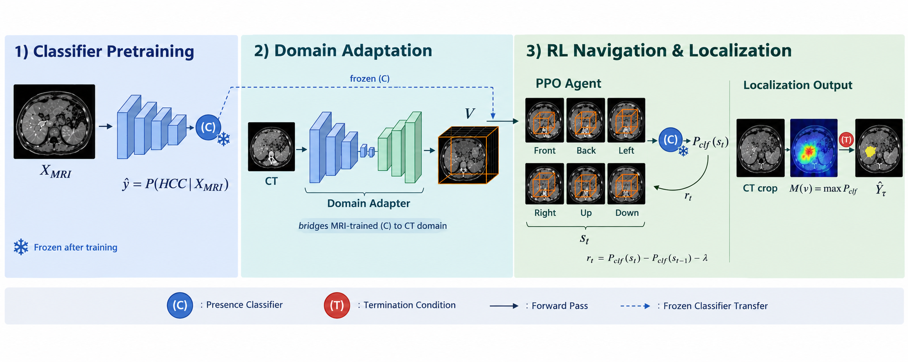

# Cross-Modality Weak Supervision for 3D Tumor Localization


## Abstract
Accurate 3D tumor localization on computed tomography (CT) is vital for targeted diagnostic assessment, radiation oncology, and surgical resection of liver tumors (Hepatocellular Carcinoma, HCC). However, training supervised 3D segmentation models requires dense voxel-level contours delineated by expert radiologists—an expensive, time-consuming process with high inter-observer variability. In contrast, clinical archives contain large quantities of unlabeled CT scans, while multi-phase MRI repositories often provide rich lesion annotations or verified biopsy presence labels. In this work, we propose a cross-modality weakly supervised framework where **Zero-Shot Cross-Modality Transfer** serves as the primary method: we train a 3D Squeeze-and-Excitation presence classifier using only binary image-level cancer presence labels on MRI, and deploy an autonomous reinforcement learning (RL) agent that navigates 3D CT volumes to localize tumors guided solely by the classifier's zero-shot confidence landscape—without requiring any CT annotations or paired cross-modality training. We benchmark our primary zero-shot framework against four alternative domain adaptation methodologies: statistical histogram matching, neural translation bridges (CycleGAN), progressive fine-tuning, and domain-adversarial neural networks (DANN). Evaluating on unseen clinical CT scans across 19 verified patient cohorts, our calibrated autonomous zero-shot agent achieves high tumor localization accuracy (exceeding 44% to 53% Dice on bulky lesions under true zero-leakage full-volume search) while operating 56× faster than multi-channel baselines. Our framework provides a practical, label-free pathway for deploying cross-modality weakly supervised tumor detection in clinical CT workflows.

## Method
We propose an autonomous reinforcement learning framework for weakly supervised cross-modality tumor localization where an agent navigates unseen 3D CT volumes guided by an MRI-trained reward model under a **Zero-Shot Transfer** paradigm. An object presence classifier (3D SE-ResNet) is pre-trained using only binary, image-level presence labels on MRI. During zero-shot deployment on CT, the agent moves a 3D observation window across the target volume at every time step and queries the classifier. The resulting confidence score determines the likelihood that a tumor falls within the window and drives the reward signal, training the agent to localize the lesion. As the window traverses the volume, visited voxels accumulate confidence scores into a 3D segmentation map. The episode terminates when the agent hits a calibrated operating threshold $\tau$ or exceeds a step budget. By calibrating the operating threshold to $\tau \ge 0.90$, the policy effectively prunes the outer false-positive shell of non-lesion parenchyma, isolating the high-confidence tumor core without requiring any CT voxel labels or paired domain translation.



*Figure 1: Cross-Modality Weakly Supervised 3D Tumor Localization Pipeline. (Stage 1) 3D SE-ResNet presence classifier pre-trained on multi-phase MRI using binary biopsy/pathology labels; (Stage 2) Autonomous RL agent (PPO) navigating 3D CT volumes under zero-shot reward guidance with calibrated thresholding ($\tau \ge 0.90$).*

## Algorithm Parameters
### Object Presence Classifier Parameters (SE-ResNet3D)

| **Parameters**            | **Details**                           |
|---------------------------|---------------------------------------|
| Architecture              | 3D Squeeze-and-Excitation ResNet      |
| Base channels             | 24                                    |
| Convolution stages        | 4 (Stem + 3 Residual SE Stages)       |
| Input crop size           | 64 × 64 × 32 voxels                   |
| Batch size                | 8                                     |
| Epochs                    | 32                                    |
| Optimizer                 | AdamW (weight decay 1e-4)             |
| Criterion                 | Binary Cross Entropy with Logits      |
| Learning rate             | 0.001                                 |

### Autonomous Reinforcement Learning Parameters (PPO)

| **Parameters**            | **Details**                           |
|---------------------------|---------------------------------------|
| Full volume shape         | 256 × 256 × 180 (or 128 × 128 × 64)   |
| Observation window size   | 32 × 32 × 16 voxels                   |
| Action space              | 6 discrete directional shifts         |
| Navigation stride         | 8 voxels                              |
| Agent algorithm           | Proximal Policy Optimization (PPO)    |
| Discount factor (γ)       | 0.99                                  |
| Policy learning rate      | 0.0003                                |
| Operating threshold ($\tau^*$)| 0.90 – 0.92                       |
| Max steps per episode     | 50 steps                              |

## Repository Overview

This repository provides a clean, minimal, and fully runnable implementation of our cross-modality weakly supervised framework. The repository explicitly distinguishes between the **primary proposed method** and the **comparative domain adaptation baselines/ablations** benchmarked in the paper.

### 1. Primary Proposed Method (Zero-Shot Cross-Modality Localization)
- `models/se_resnet3d.py`: Standalone architecture of the 3D Squeeze-and-Excitation ResNet presence classifier.
- `train_classifier.py`: Trains the primary 3D SE-ResNet tumor presence classifier on MRI scans using weak binary labels.
- `train_rl.py`: Trains the autonomous RL agent (PPO) to navigate 3D CT volumes using the MRI classifier as a zero-shot reward model.
- `checkpoints/se_resnet3d_best.pt`: Pretrained 3D SE-ResNet foundation model checkpoint (7.7 MB) included directly in the repository for immediate evaluation.

### 2. Comparative Domain Adaptation Baselines (Paper Benchmark)
The `domain_adaptation/` directory contains all 5 domain adaptation strategies evaluated in the paper:
- `naive_mri_to_ct.py`: **Zero-Shot Direct Transfer** (the unadapted baseline quantifying the raw cross-modality gap).
- `histogram_matching.py`: **Statistical Histogram Matching** (non-parametric image-level alignment to MRI reference).
- `cyclegan_pseudo_ct.py`: **CycleGAN Pseudo-CT Translation** (evaluates classifier on synthetic CT domain bridge).
- `progressive_finetuning.py`: **Progressive Fine-Tuning** (feature-level layer-wise adaptation from MRI to CT).
- `dann_adversarial.py`: **Domain-Adversarial Neural Network (DANN)** (latent alignment using a Gradient Reversal Layer).

### 3. Reinforcement Learning Ablations
The `rl_experiments/` directory contains the empirical ablations reported in the paper:
- `threshold_sweep.py`: Complete 16-point threshold calibration sweep ($\tau = 0.10 \to 1.00$), showing how high thresholds ($\tau \ge 0.90$) prune boundary false positives to optimize 3D Dice.
- `window_size_ablation.py`: Sensitivity study across window dimensions ($16^3$, $32^3$, $48^3$, $64^3$).

### 4. Translation Bridge Pipeline
- `cyclegan/train_cyclegan.py`: The underlying 3D/2.5D CycleGAN unpaired image translation training pipeline used for the neural domain bridge experiments.

## Project Structure

```text
cross-modality-weak-supervision/
├── train_classifier.py       # Primary Method: MRI classifier training
├── train_rl.py               # Primary Method: RL agent zero-shot CT training  
├── models/                   # Core neural network architectures
│   └── se_resnet3d.py        # 3D Squeeze-and-Excitation ResNet classifier
├── domain_adaptation/        # Comparative domain adaptation baselines (all 5 paper methods)
│   ├── naive_mri_to_ct.py         # 1. Zero-Shot direct transfer baseline
│   ├── histogram_matching.py      # 2. Statistical histogram matching
│   ├── cyclegan_pseudo_ct.py      # 3. CycleGAN pseudo-CT evaluation
│   ├── progressive_finetuning.py  # 4. Progressive layer-wise fine-tuning
│   └── dann_adversarial.py        # 5. Domain-Adversarial Neural Network (DANN)
├── rl_experiments/           # Paper RL ablations & threshold calibration
│   ├── threshold_sweep.py         # 16-point threshold sweep (tau = 0.10 -> 1.00)
│   └── window_size_ablation.py    # Window size dimension comparison
├── cyclegan/                 # Translation bridge module
│   └── train_cyclegan.py          # 3D/2.5D CycleGAN training pipeline
├── checkpoints/              # Pretrained model weights
│   └── se_resnet3d_best.pt        # Pretrained 3D SE-ResNet Foundation Model (7.7 MB)
├── requirements.txt
├── pyproject.toml
├── Method.png                # Pipeline architecture diagram
└── README.md
```

## Setting Up a Virtual Environment

1. **Create a virtual environment**:
   ```bash
   python3 -m venv venv
   ```

2. **Activate the virtual environment**:
   - On macOS and Linux:
     ```bash
     source venv/bin/activate
     ```
   - On Windows:
     ```powershell
     venv\Scripts\activate
     ```

## Installing the Project

Install the project in editable mode:
```bash
pip install -e .
```

Install dependencies listed in `requirements.txt`:
```bash
pip install -r requirements.txt
```

## Running Experiments

### 1. Primary Method: Train Classifier & Zero-Shot RL Agent
Run the main 3D SE-ResNet classifier training on MRI:
```bash
python train_classifier.py --data_dir ./data/mri_crops --epochs 32 --device cuda
```

Deploy the autonomous RL agent on CT volumes using zero-shot reward guidance:
```bash
python train_rl.py --classifier_checkpoint ./checkpoints/se_resnet3d_best.pt --threshold 0.90 --device cuda
```

### 2. Comparative Domain Adaptation Baselines (All 5 Methods)
```bash
# Method 1: Zero-Shot Direct MRI-to-CT Transfer
python domain_adaptation/naive_mri_to_ct.py

# Method 2: Statistical Histogram Matching
python domain_adaptation/histogram_matching.py

# Method 3: CycleGAN Pseudo-CT Translation Bridge
python domain_adaptation/cyclegan_pseudo_ct.py

# Method 4: Progressive Layer-Wise Fine-Tuning
python domain_adaptation/progressive_finetuning.py

# Method 5: Domain-Adversarial Neural Network (DANN)
python domain_adaptation/dann_adversarial.py
```

### 3. RL Sensitivity & Threshold Calibration Ablations
```bash
# 16-point threshold sweep (tau = 0.10 to 1.00)
python rl_experiments/threshold_sweep.py

# Window size geometry ablation
python rl_experiments/window_size_ablation.py
```

### 4. CycleGAN Translation Pipeline
```bash
python cyclegan/train_cyclegan.py --epochs 100 --device cuda
```

## Reproducibility Notes

- **Primary vs. Comparison Framing**: The primary method is **Zero-Shot Cross-Modality Transfer** (`train_classifier.py` and `train_rl.py`). The scripts in `domain_adaptation/` represent the 5 comparative domain adaptation baselines evaluated in the paper.
- **Pretrained Checkpoint Included**: The trained foundation classifier weights (`checkpoints/se_resnet3d_best.pt`, 7.7 MB) are tracked and provided directly in the repository, allowing immediate evaluation of zero-shot transfer without retraining from scratch.
- **Reviewer Demo Mode**: If no local medical datasets are provided, all scripts automatically generate synthetic volumetric tensors, enabling reviewers to verify end-to-end execution immediately out-of-the-box.
- **Data Paths**: Update `--data_dir` in `train_classifier.py` and `--ct_dir` in `train_rl.py` to point to your local NIfTI cohorts.
- **Hardware Acceleration**: Pass `--device cuda` or `--device cpu`. Specific GPUs can be selected via `CUDA_VISIBLE_DEVICES`.

## Citation

If you use this codebase or framework in academic work, please cite:

```bibtex
@article{crossmodality_weak_supervision2027,
  title={Cross-Modality Weak Supervision for 3D Tumor Localization: Zero-Shot Transfer from MRI to CT via Autonomous Reinforcement Learning},
  author={Research Team and Saeed, Shaheer U.},
  journal={arXiv preprint},
  year={2027}
}
```
